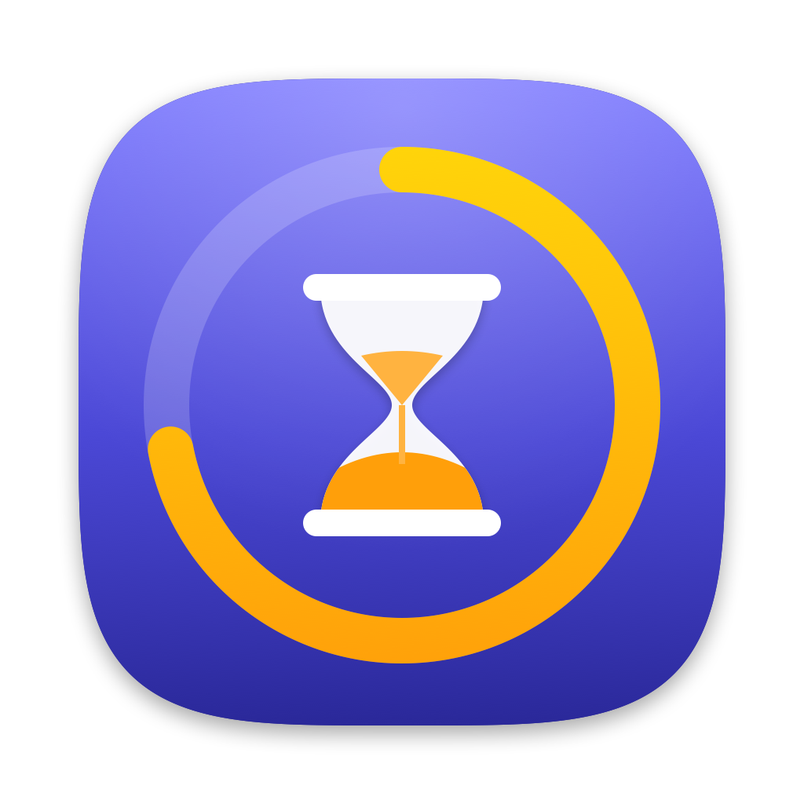

# Screen Limiter



Makes **Chrome and Firefox** time count in **macOS Screen Time**. The website limits you set in System Settings → Screen Time then also apply in those browsers, and combine with your iPhone and iPad through *Share Across Devices*. On its own, Screen Time on the Mac only sees Safari.

```
browser extension ──native messaging──▶ ScreenLimiterHost ──distributed notification──▶ Screen Limiter.app
 (active tab, focus, idle)               (inside the app)                                (STWebpageController → Screen Time)
        ◀──────────────────── "blocked" when Screen Time says the site is over its limit ────────────────────
```

The menu-bar app hands the active tab's URL to an [`STWebpageController`](https://developer.apple.com/documentation/screentime/stwebpagecontroller), the API Apple gives browsers for Screen Time reporting. Screen Time counts the time and answers with `urlIsBlocked`. When a site is over its limit, the extension swaps the tab for a "Time Limit Reached" page.

> Status: proof of concept (spike S7 in [PLAN.md](PLAN.md)). Personal use; macOS 27.

## What we learned about `STWebpageController`

- It only gets verdicts while its view is in **a window**. A transparent 1×1 window is enough.
- **Only the first controller in a process works.** Create one and keep it.
- Limits are evaluated **when the URL is set** (0.2–0.4 s later), so the app re-submits every 10 s to catch limits that run out mid-page. For ~0.4 s after a change, `urlIsBlocked` still reflects the previous URL.
- `setBundleIdentifier` is restricted to registered browsers, so usage appears in Screen Time under **Screen Limiter**, not Chrome or Firefox.

## Build & run

```bash
mac/build.sh --run
```

This needs Xcode 27 (no project file; `swiftc` builds the bundle). It signs with your Apple Development identity if you have one, otherwise ad hoc. The app lives in the menu bar (hourglass) and registers the native-messaging host for Chrome and Firefox at launch.

## Install the extension

`mac/build.sh` runs `extension/build.sh`, which assembles `extension/dist/{chrome,firefox}`.

- **Chrome:** `chrome://extensions` → Developer mode → **Load unpacked** → `extension/dist/chrome`. The ID is pinned by the manifest `key` (`mbjjdikleafaggmieedmcbheipibhhfi`).
- **Firefox:** `about:debugging#/runtime/this-firefox` → **Load Temporary Add-on…** → `extension/dist/firefox/manifest.json`. Temporary add-ons are removed when Firefox quits; a permanent install needs Mozilla signing.

Then add website limits in System Settings → Screen Time → App Limits.

## Developer tools

| Command | What it does |
|---|---|
| `ScreenLimiter --probe <url> [config]` | Feeds `<url>` to a fresh controller and prints Screen Time's verdict (`reuse`, `pixel`, `nowin`, or window configs like `big,small`) |
| `ScreenLimiter --snapshot <dir>` | Renders the menu and Settings UI to PNGs with demo data |
| `defaults write dev.screenlimiter.mac debugIgnoreFrontmost -bool YES` | Skips the "browser is frontmost" check for scripted tests |
| `swift tools/make-icon.swift <dir>` | Renders the app and extension icons |

(The binary is `mac/build/Screen Limiter.app/Contents/MacOS/ScreenLimiter`.)

## Layout

| Path | What |
|---|---|
| `mac/Sources/App` | Menu-bar app (SwiftUI). `Bridge.swift` is the core |
| `mac/Sources/Host` | Native-messaging host |
| `extension/src`, `extension/manifests` | Shared MV3 extension + per-browser manifests |
| `PLAN.md` | Research, platform constraints, and the wider cross-device plan |
